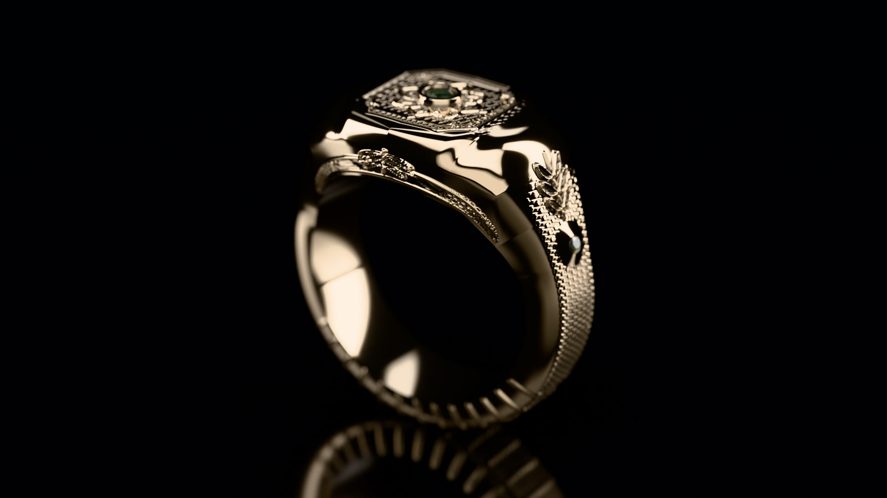
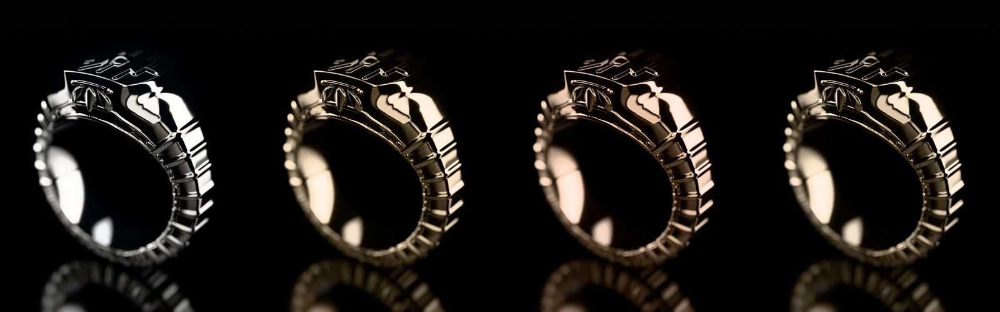
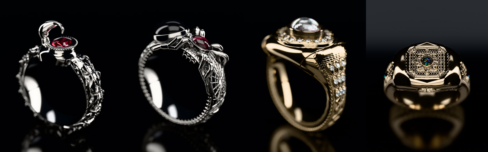
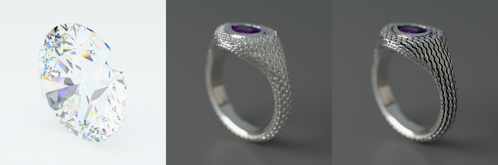
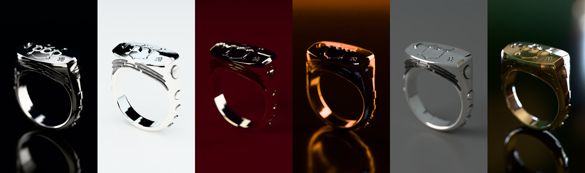

# argent

A spectral path tracer for jewelry. Give it the STL you cast from and it gives you the listing photo, every metal
variant, a turntable reel, a GLB for a store's 3D viewer, and a live studio you can art-direct from a phone. No
photoshoot and no GPU: it runs on CPU cores at idle priority (a 1920×1080 still at 256 samples takes about 30 s on
32 cores).



```sh
argent info thanatos.stl                                   # size, ring size, weight in every alloy
argent render thanatos.stl --metal gold14k -o hero.png     # brand look (noir studio), 1080x1920
argent render thanatos.stl --studio white --size listing   # marketplace white, 2000x2000
argent turntable thanatos.stl --hook "Death had a name: Thanatos" --qc -o reel.mp4
argent sheet thanatos.stl --metals sterling,gold14k,rose14k,bronze -o listing/
argent glb thanatos.stl -o thanatos.glb                    # web/AR model for a product page
argent batch library/ -o catalog/                          # every piece, index.html
argent serve                                               # live studio on :8790
```

More:

```sh
argent turntable ring.stl --rig reveal --audio track.mp3 -o reel.mp4   # macro rack-focus dolly-out; the drop lands on the reveal
argent turntable ring.stl --rig sweep -o glint.mp4                     # a strip light glides across the polish
argent render ring.stl --hdri studio_small_08_2k.hdr --hdri-rotate 120
argent render skull.ply --fit 26 --chain on --rotate z-90,y-90         # unknown units → 26 mm, upright, on a cable chain
argent --marker --detach turntable ring.stl -o out/reel.mp4            # background job for agents; tail out/reel.mp4.log
```


<sub>One mesh, four alloys: sterling, 14k gold, 14k rose, bronze. There are no tints: each colour comes from the
metals' measured refractive indices.</sub>


<sub>Stones come from the CAD export: ruby and black spinel (Manticora), garnet and onyx (Arachne), Oriel's 37
stones in 18k gold, and a black opal set in Nocturne.</sub>


<sub>Dispersion gives a brilliant cut its spectral fire. Ophidian without and with the antique patina: tarnish
settles into the recesses and the high points stay polished.</sub>


<sub>One ring in the noir, white, velvet, ember and window studios, then lit by a photographed HDRI.</sub>

## Why it looks like a photograph

| | |
|---|---|
| **Spectral metals** | Measured complex refractive indices (Johnson & Christy, Rakić) with exact Fresnel per wavelength. Gold, rose gold and bronze get their colour from physics, not a tint. Alloys (sterling, 14k/18k, rose, bronze, brass) are mixed from their pure metals. Light that bounces metal to metal is multiplied per wavelength, so gold inside a gold band deepens the way it does in a photograph. GGX with multi-scatter compensation keeps satin finishes from going dark. |
| **Tone** | Khronos PBR Neutral by default, which keeps a product's hue and saturation into the highlights. AgX looks are there (`--grade punchy\|base\|golden`), but their path to white turned 24k gold khaki: sRGB 197/173/124 under AgX against 241/205/146 under Neutral. |
| **Studio rigs** | Polished metal is a mirror: it looks like metal only when it reflects large, soft-edged light next to black. `noir` (brand: black, strip softboxes, black acrylic), `white` (listing: tent + black flags so polish keeps its edges), `velvet`, `ember` (underworld fire rims), `window`. Softboxes are feathered so highlights grade like real diffusion, and white balance follows each rig's strobes. |
| **Camera** | 100 mm macro on full frame, f/16 by default in mood studios with autofocus on the subject, sharp for listings. For every view the piece turns while the lights and camera stay put, so the highlights stay where a photographer would put them. |
| **Antique finish** | Every piece gets a cavity mask (ambient occlusion + curvature) at load time. `--patina` blends a soft black tarnish into the recesses while the polished highs stay bright: the liver-of-sulfur look of a hand-finished skull ring. |
| **Real gems** | Sellmeier dispersion with hero-wavelength sampling, so diamonds throw spectral fire. Absorption spectra give sapphire, ruby, emerald and the rest their colour through the stone's depth. |
| **Spectral opal** | Precious opal is diffraction, not pigment: each Voronoi domain is a lattice reflecting a narrow band at `λ = 2 d n cos θ`. Turn the piece and the flashes shift colour, as real opal does. |
| **Photographed light** | `--hdri` lights the piece with an equirectangular HDR (importance-sampled, MIS with the softboxes); rotating it moves every highlight. |

## Production

| | |
|---|---|
| **Auto-pose** | Finds a ring's finger hole and head, a pendant's bail and front, and frames the shot. `--flip`, `--rotate`, `--angle` override. |
| **CAD aware** | RingDesigner exports pair automatically: `ring.stl` brings `ring_stones.obj`, and each stone's gem comes from the `_stones.json` label (or its tint when the label names no gem). |
| **Pendants hang** | A procedural cable chain runs through the bail in a V (`--chain auto` for detected pendants). |
| **Reels with timing** | Rigs: `turntable`, `reveal` (macro, rack focus, dolly out, turn), `sweep` (moving strip light). `--audio` finds the track's drop and lands it on the rig's main moment. Hooks are burned in without breaking words. |
| **Reel spec** | 1080×1920, 30 fps, h264 yuv420p with BT.709 tags, AAC 48 kHz at −14 LUFS with true peak under −1 dBTP, < 25 Mbps. `--qc` runs 12 delivery checks: stream, resolution, frame rate, pixel format, audio, duration, bitrate, file size, black stretches, frozen stretches, loudness and true peak. |
| **Web 3D** | `argent glb` simplifies to a triangle budget (quadric error; a 2.5 M-triangle ring kept within 0.01 mm at 150 k) and writes a GLB with PBR metal, stones as transmissive glass and the patina baked into vertex colour, sized for Shopify's 3D product media. |

## Live studio

`argent serve --library DIR --out DIR` is a phone-first studio: open a piece from the library, drag to orbit,
change metal, patina, polish, studio, HDRI, stones and grade, and watch the path-traced frame refine live
(half-resolution frames at ~12 fps while you move, then progressive refinement, OIDN-denoised). Final stills,
listing sheets and reels queue as jobs and land under `--out`. The same set is a JSON + WebSocket API for agents:
`crates/argent/src/serve/API.md`. It renders only while someone is looking and idles 20 s after the last request.

## Layout

| Crate | Does |
|---|---|
| `argent-core` | BVH (binned SAH → 4-wide SIMD), Owen-scrambled Sobol, spectral path tracer with NEE+MIS, GGX with multi-scatter compensation, materials, studios, framing, the `Prepared`/`Look` shot API |
| `argent-mesh` | STL/OBJ/PLY/3MF readers, welding, crease-aware normals, ring/pendant pose detection, cavity masks |
| `argent-spectra` | CIE 1931 observer, D65, RGB→spectrum (Jakob–Hanika), metal n,k tables, alloys, gem optics |
| `argent-post` | OIDN denoising (runtime-loaded) with an à-trous fallback, Khronos PBR Neutral and AgX tone mapping, PNG/JPEG/EXR, ffmpeg video, contact sheets, hooks, reel QC |
| `argent-export` | Quadric-error simplification and a glTF 2.0 binary writer (`KHR_materials_transmission`, `_ior`, `_volume`) |
| `argent` | the CLI and the live studio server |

## Build

Rust 1.85 or newer (edition 2024):

```sh
cargo build --release -p argent        # target/release/argent
cargo test --workspace --release
```

Reels and `--qc` need `ffmpeg` and `ffprobe` on `PATH` (or `ARGENT_FFMPEG` / `ARGENT_FFPROBE`). Intel Open Image
Denoise 2.x is optional: argent loads it at run time from `$ARGENT_OIDN_DIR/lib` or `~/.local/opt/oidn-*/lib` and
falls back to its own à-trous filter without it.

Any STL, OBJ, PLY or 3MF works; units default to millimetres (`--units`, `--fit`). The pieces shown above are
[RingDesigner](https://github.com/shadowbrok3r/RingDesigner) designs. Their meshes (2.6 GB) aren't in this repo;
`assets/README.md` records how they were exported.

## Deploy

The author's setup, a user service on a tailnet address (change `--host` in the unit):

```sh
cargo build --release -p argent && install -m755 target/release/argent ~/.local/bin/argent
cp deploy/argent-studio.service deploy/argent-desktop-catalog.* ~/.config/systemd/user/
systemctl --user daemon-reload && systemctl --user enable --now argent-studio argent-desktop-catalog.timer
```

`deploy/zeroclaw-skill/argent/SKILL.md` teaches a ZeroClaw agent the commands; outputs written inside the agent's
workspace come back as `[IMAGE:…]`/`[VIDEO:…]` attachments with `--marker`.

## License

MIT or Apache-2.0, at your option. EB Garamond, used for reel hooks, is under the SIL Open Font License
(`crates/argent-post/assets/fonts/FONT-LICENSE.txt`).
